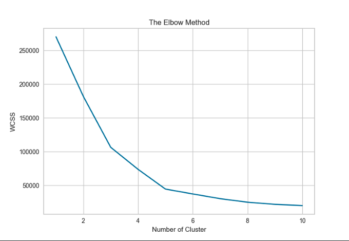
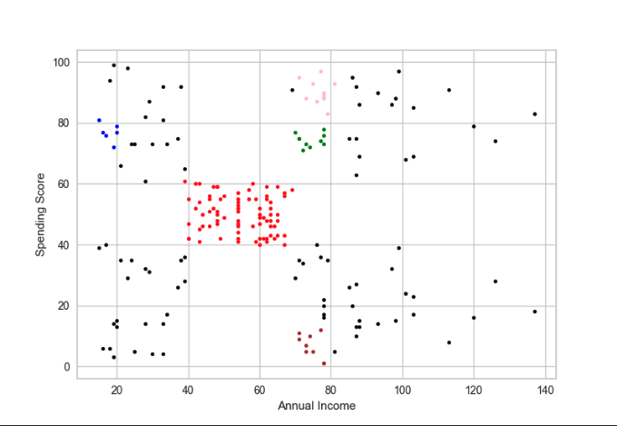
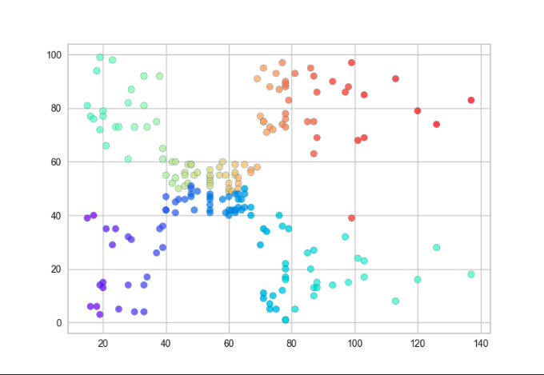

# Welcome to my Machine Learning Research Project

## I Conducted This During Independent Research At the University of the Virgin Islands

A Python script that compares three clustering algorithms (K-means, DBSCAN and BIRCH) with scikit-learn, grouping 200 mall customers by annual income and spending score.

A school project from 2023.

(Please note all credit for the data collected goes to the following GitHub repo https://gist.github.com/pravalliyaram/5c05f43d2351249927b8a3f3cc3e5ecf), This research is for educational purposes only.

Within this Repo I have attached a PowerPoint presentation as well as The Research Report. I have also included the results of the code provided.

Here is the charts that are displayed as an outcome:

# K-Means:


# DBSCAN


# BIRCH


## Running it

You need Python 3.14 (the versions in `requirements.txt` were tested with it on macOS). From the repo folder:

```sh
python3.14 -m venv .venv
source .venv/bin/activate
pip install -r requirements.txt
python main.py
```

The script opens each chart in a window; close it to move on to the next. At the end it prints the time each algorithm took and the DBSCAN and BIRCH silhouette scores (0.114 and 0.323, the same as in `Code_Results.txt`). To run it without windows, use `MPLBACKEND=Agg python main.py`.

On Linux, where file names are case sensitive, the script will not find the dataset: it opens `Mall_customers.csv` while the file is `Mall_Customers.csv`.

## Dataset

`Mall_Customers.csv` holds 200 customers (ID, gender, age, annual income, spending score). It came from the gist credited above. The same data is on Kaggle as [Mall Customer Segmentation Data](https://www.kaggle.com/datasets/vjchoudhary7/customer-segmentation-tutorial-in-python), whose page says it comes from Udemy's Machine Learning A-Z course and lists its licence as "Other (specified in description)" without stating any terms.

## What I would do differently today

- **Pinned versions.** The original run kept no list of versions. `requirements.txt` now pins the ones tested here, and yellowbrick 1.5 already breaks on the newest scikit-learn.
- **A fixed random seed.** K-means starts from random centres; setting `random_state` would make every run give the same curve and scores.
- **Fairer timings.** Each timer also covers the plotting and the time a chart window stays open, and the K-means timer covers ten fits, so the times compare more than the algorithms.
- **The limits of the study.** Two features, 200 customers, unscaled data, a hand-picked DBSCAN `eps` and one measure (the silhouette score) are enough for a class comparison, not for general claims about the algorithms.
